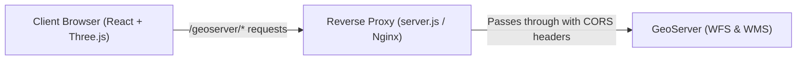

# Canopy — Deployment Guide

This guide covers deployment options, environment variable configuration, GeoServer setup, CORS handling, and production optimization for the Canopy 3D Tree Census application.

---

## 1. Architecture Overview

Canopy connects directly to a GeoServer backend to stream geospatial tree census features via **WFS (Web Feature Service 2.0.0)** and **WMS (Web Map Service 1.1.0)**.



To prevent browser **Cross-Origin Resource Sharing (CORS)** blocks, production deployments typically use a reverse proxy or same-origin routing (`server.js`).

---

## 2. Environment Variables Reference

Canopy configures all server connections using Vite-standard environment variables:

| Variable | Default Value | Description |
|---|---|---|
| `VITE_GEOSERVER_TARGET_SERVER` | `https://www.ornettreecensus.com` | Target GeoServer host URL (e.g. `https://your-geoserver.com`). |
| `VITE_USE_PROXY` | `true` (in dev) / `false` (in prod static) | When `true`, routes GeoServer requests through `/geoserver/*` on same origin. |
| `VITE_DEFAULT_WORKSPACE` | `nashiktreecensus` | Default GeoServer workspace loaded if no `?citycode=` or `?workspace=` is in URL (also accepts `VITE_GEOSERVER_WORKSPACE`). |
| `VITE_DEFAULT_LAYER_NAME` | `nashiktreecensus` | Default GeoServer layer loaded if no `?citycode=` or `?layer=` is in URL (also accepts `VITE_GEOSERVER_LAYER_NAME`). |
| `VITE_GEOSERVER_GEOMETRY_COLUMN`| `geom` | PostGIS geometry column name in GeoServer layer. |
| `VITE_GEOSERVER_SRS` | `CRS:84` | Spatial reference system (WGS84 lon/lat). |
| `PORT` | `3000` | Port listened to by Node.js `server.js` in production. |

---

## 3. Recommended Deployment: Cloud Node Host (Render, Railway, Fly.io, Heroku)

Deploying with Node.js ensures the bundled [`server.js`](server.js) runs alongside the static frontend, acting as an automatic CORS-free reverse proxy.

### Step-by-Step Render Deployment:

1. **Push your code to Git** (GitHub, GitLab, or Bitbucket).
2. Go to [Render Dashboard](https://dashboard.render.com) ➔ **New** ➔ **Web Service**.
3. Select your repository.
4. Fill in the build settings:
   - **Environment**: `Node`
   - **Build Command**:
     ```bash
     npm install && npm run build
     ```
   - **Start Command**:
     ```bash
     npm start
     ```
     *(Runs `node server.js` which automatically binds to `0.0.0.0` and Render's dynamic `$PORT`)*.
5. In the **Environment** tab, set your production variables:
   - `VITE_GEOSERVER_TARGET_SERVER`: `https://your-geoserver.com`
   - `VITE_USE_PROXY`: `true`
   - `VITE_DEFAULT_WORKSPACE`: `your_default_workspace`
   - `VITE_DEFAULT_LAYER_NAME`: `your_default_layer`
6. Click **Deploy Web Service**.

---

## 4. Alternative: Static Deployment (Vercel, Netlify, Cloudflare Pages, AWS S3)

If hosting purely static HTML, JS, and GLB files without a Node server:

1. **Verify GeoServer CORS**:
   Ensure your remote GeoServer has CORS enabled in its `web.xml` or reverse proxy:
   ```xml
   <filter>
     <filter-name>CorsFilter</filter-name>
     <filter-class>org.apache.catalina.filters.CorsFilter</filter-class>
     <init-param>
       <param-name>cors.allowed.origins</param-name>
       <param-value>*</param-value>
     </init-param>
   </filter>
   ```
2. **Build Settings**:
   - **Build Command**: `npm run build`
   - **Output Directory**: `dist`
3. **Environment Variables**:
   ```env
   VITE_GEOSERVER_TARGET_SERVER=https://your-geoserver.com
   VITE_USE_PROXY=false
   VITE_DEFAULT_WORKSPACE=your_default_workspace
   VITE_DEFAULT_LAYER_NAME=your_default_layer
   ```

---

## 5. GeoServer Layer Requirements

For optimal compatibility with Canopy:

1. **WFS 2.0.0 Enabled**:
   - The layer must be queryable via WFS `GetFeature` with GeoJSON output (`outputFormat=application/json`).
   - Spatial queries use CQL predicates (`BBOX(geom, minX, minY, maxX, maxY, 'CRS:84')`).
2. **Layer Properties**:
   Canopy automatically projects and consumes the following attributes if available:
   - `Tree_UID` / `id`: Unique identifier for instancing stability.
   - `Height`: Tree height in metres (controls 3D model scale).
   - `LocalName`: Common/local tree name (drives palm/broadleaf classification).
   - `Specie`: Species group (e.g., `Indigenous`, `Exotic`).
   - `HealthCondition`: Health label (`Healthy`, `Fair`, `Average`, `Dead`, `Dangerous`, `Mechanically Cut`, `Uprooted`).
   - `IsHeritageTree`: `Yes` / `No` (activates gold heritage tree tinting).
   - Extended inspection fields: `Girth`, `Canopy`, `AgeGroup`, `TreePhoto`, `WardNameOrNum`.
3. **Spatial Indexing**:
   - Ensure a spatial GiST index is built on the PostGIS geometry column:
     ```sql
     CREATE INDEX idx_trees_geom ON tree_census USING GIST (geom);
     ```

---

## 6. Multi-Municipality URL Routing

Canopy is architected to serve multiple cities from a single deployed URL without requiring separate builds:

- `https://your-domain.com/?citycode=tmc`
- `https://your-domain.com/?citycode=nashik`
- `https://your-domain.com/?citycode=panvel&lat=18.99&long=73.11`
- `https://your-domain.com/?workspace=custom_ws&layer=custom_layer`

Municipal boundary files should be placed in `public/kml/{citycode}_kml.kml`.

---

## 7. Performance & Production Tuning

- **Viewport Debouncing**: Map panning/zooming debounces WFS requests by `220ms` (`MOVE_QUERY_DEBOUNCE_MS`), aborting any in-flight requests using `AbortController`.
- **Level of Detail Tiers**:
  - `≤ 5,000` trees: High-detail broadleaf models, palm light, stump models.
  - `5,001 – 7,500` trees: Base street trees.
  - `7,501 – 16,000` trees: Ultra-low-poly conical pine (80 triangles) and layered fir (108 triangles).
  - `> 16,000` trees: GeoServer 2D WMS raster tiles.
- **GLB Asset Compression**: All 3D models in `public/models/` are pre-normalized and instanced by material to minimize draw calls on client GPUs.
